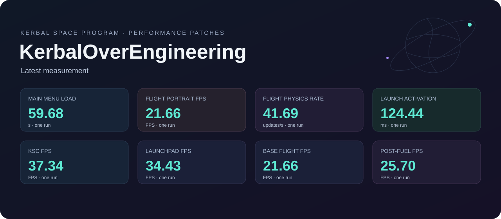
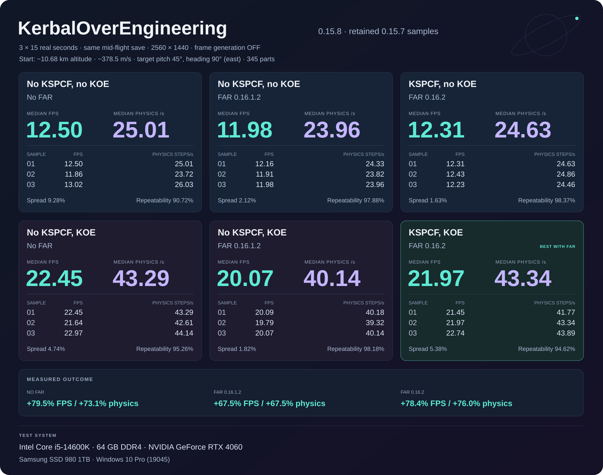
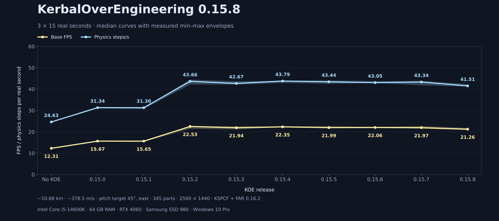
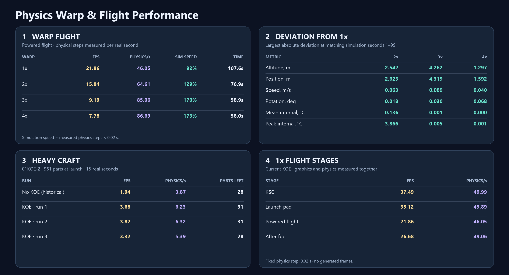

<p align="center">
  
</p>

<p align="center">
  
</p>

<p align="center">
  
</p>

<p align="center">
  <a href="https://github.com/rockmeowstar/ksp_koe/releases/tag/0.16.2"></a>
  
  
  
  <a href="#ai-disclosure"></a>
  <a href="#ai-disclosure"></a>
</p>

<p align="center">
  <a href="https://github.com/rockmeowstar/ksp_koe/releases/tag/0.16.2">Download 0.16.2</a> ·
  <a href="https://spacedock.info/mod/4787/KerbalOverengineering%20(KOE)">SpaceDock / CKAN</a> ·
  <a href="https://forum.kerbalspaceprogram.com/topic/232077-1125-kerbaloverengineering-koe-performance-optimization-for-ksp-and-its-mods/">Forum</a> ·
  <a href="https://github.com/rockmeowstar/ksp_koe/issues">Report an issue</a>
</p>

KOE optimizes loading, resource handling, scene updates and rendering in KSP and supported mods. It combines **75 individually configurable options across 39 modules**. Frame generation is optional; most features do not require an NVIDIA GPU.

**0.16.2** updates adaptive physics scheduling, improves delta-v resource lookup and fixes a FAR voxel synchronization stall. The chart below records one flight at each physical warp rate and three heavy-craft runs; actual physics speed depends on the available CPU time.

<p align="center">
  
</p>

**0.16.1** adds two physics options, both enabled by default in newly generated configurations:

- `Stock.RealtimePhysicsCatchup` adjusts the per-frame physics budget to keep simulation close to real time at low FPS, within available CPU capacity.
- `Stock.PhysicsWarpPrecision` retains the 1× physics timestep during physical warp and aligns SAS, thermal integration, autopilot and FAR updates to physics ticks, reducing divergence from 1× at a higher CPU cost.

The release also removes the global check against one specific `Assembly-CSharp` build; individual dependency checks remain. Existing configs keep their choices: enable both physics options manually or back up and remove `Options.cfg` to regenerate supported defaults, then restart KSP. The settings tabs now show a version notice when an installed mod is older than the version used during development.

**0.16.0** adds a KOE toolbar button for editing settings in-game. Most changes require restarting KSP; the window indicates which options can apply immediately. The banners at the top retain historical measurements; the 0.16.2 chart above shows the latest run.

**0.15.8** brings together the accepted rendering and loading fixes:

- EVE cloud-pass fusion and shader packing, with shared native hooks.
- Rust shader submission, shadow-draw batching and redundant blend-state cleanup.
- Scatterer screen-copy reuse and shadow-buffer cleanup.
- Flight UI cleanup, planet readiness, indexed delta-v resets and bounded DLC cache retention.

Accepted features default on when their dependencies are supported. Existing settings are preserved. Frame generation and experimental cloud-map packing remain off by default. The unsuccessful NormalizeRsq experiment is not included.

## Install

1. Install [ModuleManager](https://ksp.sarbian.com/jenkins/job/ModuleManager/) and [HarmonyKSP](https://github.com/KSPModdingLibs/HarmonyKSP).
2. Extract the release's `GameData` folder into your KSP directory. No installer executable is needed.
3. Launch once. KOE creates `GameData/KerbalOverEngineering/Options.cfg` using the dependencies it detects. Use the KOE toolbar button in the space center, editor or flight to change options, or edit the file directly. Most changes require a restart.

Existing configs are preserved. To detect all options again after an upgrade, back up and remove `Options.cfg`; the next launch recreates it. Missing keys in an existing config remain disabled. Version and patch-ownership guards can also disable unsupported or overlapping integrations.

Windows x64 / KSP 1.12.5 is the tested platform. D3D11 modules require their respective hardware and mod dependencies; the Deferred lighting path also needs [Deferred](https://github.com/LGhassen/Deferred) and [Shabby](https://github.com/KSPModdingLibs/Shabby). Frame generation requires a compatible NVIDIA Optical Flow device and D3D11; an RTX 4060 has been tested. Proton support is experimental. Native Linux and AMD frame generation are not validated.

## What is optimized?

| Area | Examples |
|---|---|
| Stock KSP | Asset preparation, resource/delta-v lookups, staging and EVA lists, terrain work, full-rate visible portraits |
| KSPCommunityFixes | Early DLC LZ4 preparation, experimental GPU drag-cube reduction, skipping redundant collision-state changes |
| EVE / Parallax Continued | Repeated cloud/material work and supported texture/terrain preparation paths |
| FAR / FreeIVA / Waterfall / Firefly | Renderer and collider lookups, refresh traversal, redundant calls and inactive-effect work |
| Rendering | Deferred light integration and optional frame interpolation with quality/deadline checks |

The 0.15.8 defaults enable `Stock.DeltaVResetIndex`, `Rendering.RustShaderSubmission` and `EVE.CloudShaderPacking`; `EVE.CloudPassFusion` requires the last option. Existing configs keep their choices and missing keys remain off: enable the desired keys manually or back up and remove `Options.cfg` to regenerate supported defaults.

Frame interpolation is disabled by default: set `FrameGeneration = true` in the `[Rendering]` section of `GameData/KerbalOverEngineering/Options.cfg` to enable it. When enabled, it uses the accepted independent-layer pipeline in conservative mode: a 60 FPS target, capped at the current monitor refresh rate. Its separate `GameData/KerbalOverEngineering/FrameGeneration.cfg` includes the experimental `FullGeneration` flag. Set it to `true` to fill toward `TargetFPS`, initially set to your monitor's refresh rate when the config is created. Both modes have a hard limit of three additional frames per rendered frame and never target more than the monitor can display. Quality checks can reject frames, so the requested rate is not guaranteed.

Integrations are grouped under [`stock/`](stock/) and [`mod/`](mod/). The complete option list and dependency categories are in [`Catalog`](core/Options/OptionStore.cs).
`Rendering.ShaderConstantUpdates` uses the validated Rust/SSE2 kernel on the supported Windows x64/D3D11 Unity build. The assembly implementation remains available for comparison. Users do not need a Rust installation; unsupported native identities retain the original path. CPU-kernel benchmark percentages are separate from whole-game FPS results.
Native builds use the checked-in Rust kernel. After editing `UniformUpdate.rs`, regenerate it with `stock/ShaderConstantUpdates/Build-Native.ps1 -RebuildRust` (Rust and Python required); a source/header mismatch stops the build. `-AssemblyOnly` builds the comparison implementation.

EVE and Parallax integrations check the APIs they use rather than assembly MVIDs. Algorithm replacements also validate IL with resolved member names, so metadata token changes alone do not reject a rebuild. Unsupported APIs keep the original mod path; shader and native Unity binary checks remain strict. Parallax's KSPTextureLoader pipeline retains upstream ownership.

EVE BC4 coverage maps use a batched Rust integral-image kernel on Windows x64, with an equivalent managed implementation as a fallback. The native library is embedded; users do not need Rust. To rebuild it, run `mod/EnvironmentalVisualEnhancements/CloudLoopFix/Build-Native.ps1` with `-Rustc` pointing to a Rust compiler and `-UpdateAsset`, then validate with `tests/Test-CoveragePrefix.ps1`. Source/binary hashes prevent packaging a stale coverage kernel. Point-light buffers are enrolled only after a recognized draw needs them; live constants are packed directly into the pending batch.

The automatic material-instancing experiment was removed: the tested Deferred bundle does not contain instancing variants for the selected shaders, and changing a material flag alone cannot supply them. Native point-light batching yields to the original Unity lights when RenderDoc is loaded; this does not guarantee compatibility with the rest of the capture stack.

## Measured performance

### Latest installed-build run

The banner's main-menu loading card uses the latest startup recheck: 48.46 s, compared with the historical no-KOE reference of 54.33 s (-10.8% time). Save entry in that recheck took 3.14 s; VAB and flight entry were not measured again. Other cards use the preceding full-flight run against the historical no-KOE reference.

One complete run with frame generation off. This installed test build includes the 0.16.0 settings interface, but its binary set differs from the published 0.16.0 archive. The following are single-run observations, not a new matched comparison. Existing caches were retained and the OS cache was not cleared.

Loading stages below belong to the preceding full-flight run; the latest main-menu recheck above replaces its startup figure in the banner.

| Full-flight run loading stage | Seconds |
|---|---:|
| Process start to main menu | 59.68 |
| Save entry | 3.64 |
| VAB | 3.47 |
| Flight entry | 11.33 |
| Total, excluding observation holds | 78.11 |

| Stage | Base FPS | Physics steps/s |
|---|---:|---:|
| KSC | 37.34 | 49.86 |
| Launch pad | 34.43 | 49.95 |
| Powered flight | 21.66 | 41.69 |
| After fuel | 25.70 | 47.29 |

Stage activation: 124.44 ms. Portrait FPS during powered flight: 21.66. Post-fuel is not a separate deep-space scenario.

### Historical full-cycle comparison (0.15.8)

One new complete run without any KOE performance modules, then one with the published 0.15.8 package. KSPCF, FAR and the other mods remain installed in both. Same craft, settings, controller and v4 flight schedule; 353 parts in VAB and 345 in flight. Frame generation is off. The figures in this table come from that pair.

| Loading stage | No KOE | KOE 0.15.8 |
|---|---:|---:|
| Main menu | 54.33 s | 50.08 s |
| Save entry | 3.17 s | 3.22 s |
| VAB | 2.98 s | 3.02 s |
| Flight entry | 12.97 s | 11.12 s |
| **Total** | 73.45 s | 67.45 s |

| Stage | FPS: no KOE | FPS: KOE | Physics/s: no KOE | Physics/s: KOE |
|---|---:|---:|---:|---:|
| KSC | 30.41 | 43.70 | 49.85 | 50.02 |
| Launch pad | 21.80 | 33.39 | 42.76 | 48.77 |
| Powered flight | 12.79 | 21.70 | 25.57 | 41.96 |
| After fuel | 20.58 | 24.08 | 40.56 | 46.37 |

| Additional metric | No KOE | KOE 0.15.8 |
|---|---:|---:|
| Portrait FPS during powered flight | 3.19 | 21.70 |
| Stage activation (`ActivateNextStage`) | 186.01 ms | 169.46 ms |

Portrait FPS is measured from actual `pilotCamera_01` render callbacks, independently of base FPS. Stage activation measures the same synchronous call in both processes; it is not the longest frame or time to load the craft. The post-fuel card covers that flight interval, not a separate deep-space scenario.

ModuleManager caches and PartDatabase were rebuilt for both runs; other existing application/mod caches were retained. OS cache was not cleared. Loading totals exclude scripted observation holds and flight time. This is one fixed-order pair, not a repeated benchmark or a fully cold-disk test. Old comparison cards and the release-history chart below remain historical measurements. [New pair data](assets/benchmarks-0.15.8.json).

### Retained 0.15.7 flight samples

Three 15-real-second mid-flight samples per configuration, starting at roughly 10.68 km and 378.5 m/s; target pitch 45°, heading east, 345 parts. Frame generation is off. Values below are medians; physics means simulation steps per real second.

| Configuration | Base FPS | Physics steps/s |
|---|---:|---:|
| FAR 0.16.1.2 | 11.98 | 23.96 |
| FAR 0.16.1.2 + KOE | 20.07 | 40.14 |
| FAR 0.16.2 + KSPCF | 12.31 | 24.63 |
| FAR 0.16.2 + KSPCF + KOE | 21.97 | 43.34 |

With FAR 0.16.2 and KSPCF held constant, KOE improved the recorded median by **78.4% in base FPS** and **76.0% in physics rate**. The banner's two **No FAR** cards are retained failure-case observations: FAR 0.16.2 did not load without its KSPCF dependency; they are not clean-uninstall controls. On FAR 0.16.1.2, seven FAR-specific KOE integrations are disabled by compatibility guards. Different FAR versions prevent attributing their difference to KSPCF alone.

The banner's repeatability index is `100 − average relative range`, averaging the FPS and physics ranges divided by their respective means. It describes these three samples and is not statistical confidence. [Sample data and limitations](assets/benchmarks-0.15.7.json).

The third chart retains the 0.15.0–0.15.7 and no-KOE samples, then adds the new three-window control for the accepted 0.15.8 configuration. Bands show the minimum and maximum window averages. Older points include recurring stock UI/EVA exception overhead; the new point has no exceptions inside its measured windows. These are retained runs, not a new randomized comparison of every release. Complete-frame calculations are used consistently across chart points. [Release-history data and exception counts](assets/release-history-0.15.8.json).

### Earlier full-cycle measurements (0.15.6)

**0.15.6 snapshot · November 7, 2026.** The latest full flight with both accepted FAR fixes is compared with the **published November 5 reference, with KSPCommunityFixes enabled and KOE completely removed**. This is a historical comparison, not a new matched A/B. Cache states and observation windows differ; the figures describe these runs and do not guarantee the same gain on another machine. Percentages are approximate because the historical reference values are rounded.

Intel Core i5-14600K · 64 GiB RAM · RTX 4060 8 GiB · 2560 × 1440 · D3D11 · NVIDIA 621.01. Craft: **01KOE, 353 parts**.

| Loading stage | KSPCF | KSPCF + KOE |
|---|---:|---:|
| Main menu | 55.12 s | 51.84 s |
| Save entry | 3.24 s | 3.21 s |
| VAB | 3.06 s | 3.06 s |
| Flight entry | 13.07 s | 11.64 s |
| **Total** | **74.49 s** | **69.74 s** |

The current total is **6.4% lower** (about 4.75 seconds), equivalent to **6.8% higher loading throughput** than the historical reference. Totals use unrounded measurements. The November 5 reference rebuilt the part cache; the current run retained existing part/application/OS caches, and module changes may invalidate individual caches. Intentional measurement holds are excluded. This is not a matched cold-start improvement measurement.

| Stage | Base FPS: KSPCF → + KOE | Change | Physics updates/s: KSPCF → + KOE | Change |
|---|---:|---:|---:|---:|
| KSC | 28.55 → 43.60 | +52.7% | 48.74 → 49.77 | +2.1% |
| Launchpad idle | 20.86 → 36.07 | +72.9% | 41.17 → 49.99 | +21.4% |
| Powered flight | 12.38 → 21.27 | +71.8% | 24.77 → 41.40 | +67.2% |
| After fuel | 18.40 → 22.81 | +23.9% | 36.40 → 43.62 | +19.8% |

**Frame generation was disabled in the current run.** Physics means real `FixedUpdate` calls per second. Powered-flight FPS includes ignition stalls; launchpad idle ends before ignition. Differences below 5% are treated as ordinary fluctuation. Visible portraits follow base rendered FPS, so the current flight portrait value is **21.27 FPS**, approximately **+588.2%** against the 3.09 FPS reference. This current portrait value follows the renderer rate; it was not sampled with a separate portrait counter during this run.

[Historical reference tables](https://forum.kerbalspaceprogram.com/topic/232077-1125-kerbaloverengineering-koe-performance-optimization-for-ksp-and-its-mods/page/2/#findComment-4546383) · [Banner data](assets/benchmarks-0.15.6.json) · [0.15.6 release](https://github.com/rockmeowstar/ksp_koe/releases/tag/0.15.6)

The launch-pause card uses the retained **previous KOE build**, not the no-KOE reference: activation took **187.41 → 134.33 ms (−28.3%)**. This measures the activation call, not the whole first-frame stall. The space/post-fuel card uses the **after-fuel window as a proxy**; a space-only interval was not separately recorded.

## Tests and completed checks

The badge above records the **latest local validation snapshot**, not a continuously running CI result. Results include retained checks from earlier iterations. Unit/algorithm checks, static IL checks, native GPU checks and full-game runs are separate forms of evidence.

| Test group | Verified result | Scope |
|---|---:|---|
| [Event paths](tests/Test-EventPaths.ps1) | 39,743 checks passed | Static patch bindings and event/resource algorithms; player-only bindings are explicitly skipped by this runner |
| [Delta-v batching](tests/Test-DeltaVReadBatch.ps1) | 7,255 checks passed | Results compared with stock `PartSet` sums |
| [KSPCF compatibility](tests/Test-Compatibility.ps1) | 103 + 11 + 9 checks passed | 16 patch combinations, unknown API and older KSPCF fixtures |
| [Cloud geometry](tests/CoverageGeometryTests.cs) | 1,717 checks passed | Geometry and culling calculations |
| [Loading budgets](tests/LoadingResourcesTests.cs) | 345 checks passed | Hardware-dependent worker/memory policy |
| [GPU drag reduction](tests/Test-DragReduction.ps1) | 48 GPU cases passed | Exact integer statistics; render/compute/OM UAV state and counters restored |
| [DLC cache](tests/Test-DlcCache.ps1) | 13 checks passed | Invalidation, corruption, source replacement and path isolation |
| [Options](tests/OptionStoreTests.cs) | 75 distinct keys checked | Config creation, preservation, dependencies and recovery |
| [Physics catch-up](tests/Test-PhysicsCatchup.ps1) | 920 checks passed | Time-budget, clock and queued-warp logic; offline checks |
| [Warp precision](tests/Test-PhysicsPrecision.ps1) | 3,214 checks passed | Patch bindings, component timesteps, FAR publication and EVA input; offline checks |
| [Game assembly compatibility](tests/Test-SettingsCompatibility.ps1) | Passed against the rebuilt options DLL | Different game MVID accepted; missing game, Harmony and Deferred still rejected |
| [FAR pool cleanup](tests/Test-FarExposurePool.ps1) | 2,005 checks passed | Reset behavior and installed FAR bindings |
| [CameraTools callbacks](tests/Test-CameraToolsLifetime.ps1) | 501 checks passed | Managed toolbar callback ownership |
| [Firefly cleanup](tests/Test-FireflyLifetime.ps1) | 400 checks passed | Managed lifetime logic; does not exercise Unity rendering |
| [FAR Rust preparation](tests/Test-FarRustFilter.ps1) | 1,425 checks; 80 owned Unity fixture cases | Filter parity, property readback, reference order, fallback and IL bindings |
| [Staging lookup](tests/Test-StageDeltaV.ps1) | 149 checks passed | Per-reset searches compared with stock lookup behavior |
| [Light buffer validity](tests/BufferValidityTests.cpp) | 935,000 differential checks passed | Full, empty and partially written buffers; 40 standalone native GPU content checks also passed |
| [Map/unmap capture](tests/MapCaptureTests.cpp) | 1,787 native checks passed | Captured/GPU bytes, interleaved mappings, thread handoff, failed maps and table rehash |
| [Capture lookup cache](tests/MapCaptureTests.cpp) | 2,532 native checks passed | Wanted-buffer transitions, context switches and capture/GPU byte parity with the cache enabled or disabled |
| [Shader constants](tests/ShaderConstantKernelTests.cpp) | 9,718 assembly checks; 9,721 Rust checks | Original Unity bytes and dirty flags, overlap and protected-page boundaries; 20,000 captured inputs replayed per backend |
| [Rust shader submission](tests/Test-RustSubmission.ps1) | 55,276 differential checks; 6 Rust tests; 17 production checks | Original Unity value application, batching, activation guards and fallback modes |
| [Cloud compiler](tests/Test-CloudPassFusion.ps1) | 21 tests passed | Rust packing and pass-fusion transformations; not a whole-scene pixel-parity claim |
| [Flight UI](tests/FlightUiLifetimeTests.cs) | 274 IL checks passed | Supported scene-cleanup callback shape; lifetime behavior checked separately in game |
| [Planet readiness](tests/Test-PlanetLaunchReadiness.ps1) | 5,287 IL/predicate checks passed | Loader ownership and readiness predicates; not universal content-parity proof |
| [Scatterer](tests/ScattererScreenCopyTests.cs) | 1,000 requests; one command build | Invalidation, cleanup and command parity; 100 shadow-buffer recreations also checked |

These numbers count checks, cases or keys as labelled—not separate test files or coverage percentages. **Line/branch coverage has not been measured.**

Additional runtime evidence:

- **Three complete reference flights:** the two new loading fixes off/on, followed by a run with all KOE modules absent. Loading and FPS telemetry sampled at 4 Hz.
- **3,660 rendered faces** matched all three original aerodynamic float outputs bit-for-bit in the earlier shadow-validation run.
- All **three DLC bundles**, totalling **1,235,882,324 decompressed bytes**, matched their originals in payload bytes and directory records.
- A deliberately corrupted cache rebuilt successfully; an exclusively locked cache fell back to the original loader. Both DLC loaded and the craft entered flight.
- Release ZIP paths use `/`; no installer, personal config or build intermediates are shipped. Original save/settings and temporarily moved mod files were verified restored after benchmarking.

### Known limits

GPU drag reduction remains experimental. Across the two-fix runs, generated part databases differed at **eight animated parts**, including geometric bounds. Separate CPU-path runs also showed variation, but the cause of every difference is unresolved. Whole-cache byte identity is **not** established. The DLC parity result above is a separate check.

Passing these checks does not establish pixel-identical output in every scene, compatibility with every mod combination, or a minimum FPS. Frame interpolation can reject frames; it produced no additional displayed frames in the reported benchmark.

<details>
<summary><strong>Run the focused checks</strong></summary>

Use Windows PowerShell with a local KSP installation. Native GPU checks require MSVC, the Windows SDK and a D3D11 device. Game assemblies are not redistributed.

```powershell
.\tests\Test-EventPaths.ps1 -GamePath "D:\Games\Kerbal Space Program"
.\tests\Test-DeltaVReadBatch.ps1 -GamePath "D:\Games\Kerbal Space Program"
.\tests\Test-Compatibility.ps1 -GamePath "D:\Games\Kerbal Space Program"
.\tests\Test-DragReduction.ps1
.\tests\Test-DlcCache.ps1
```

</details>

## Code style and engineering standards

- **C#:** four spaces, Allman braces and multiline control statements, as configured in [`.editorconfig`](.editorconfig).
- **C++:** Microsoft-based formatting, four spaces and a 120-column target. Include order and comment wrapping are preserved; see [`.clang-format`](.clang-format).
- **Patch boundaries:** validate supported dependency identities and method shapes; avoid competing patch ownership and retain the original path when an integration cannot apply.
- **Correctness:** compare against upstream calculations/content; preserve float operation order where physics depends on it. Report static, algorithmic, runtime and visual validation separately.
- **Changes:** keep modules isolated and configurable; preserve user settings. AI-written limitation comments use the marker `AI-generated comment:`.

Formatting rules are contributor targets, not a measured style-compliance score or a claim that every existing line has been normalized. Contributions should include a clear regression case, relevant checks and the dependency versions tested.

## AI disclosure

| Contribution | Estimated AI-generated share | Remaining share |
|---|---:|---:|
| Project code | **39%** | **61%** |
| Tests | **80%** | **20%** |

**KOE uses AI-generated code and tests; it is not entirely AI-generated.** These are maintainer-provided estimates, not independently audited line counts, coverage figures or quality scores. The maintainer reviews changes; review and validation remain necessary regardless of authorship.

AI-generated tests can repeat assumptions made in generated implementation. Their existence alone does not prove correctness: comparisons with stock behavior, compatibility checks and runtime measurements provide separate evidence. Bug reports and reviewed pull requests are welcome.

## License

Original KOE source is [MIT](LICENSE). Some bundled components have separate terms, including the **GPL-3.0 Deferred-derived lighting shaders and combined plugin binary**. See the module-by-module [license list](LICENSES.md) and [`licenses/`](licenses/) for the applicable notices. KSP, Unity, mod runtimes and NVIDIA drivers retain their upstream licenses.
