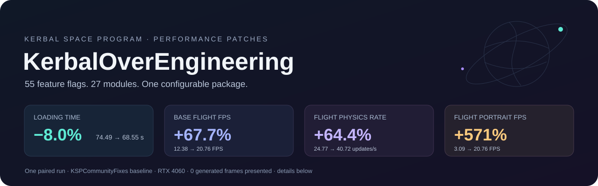

<p align="center">
  
</p>

<p align="center">
  <a href="https://github.com/rockmeowstar/ksp_koe/releases/latest"></a>
  
  
  
  <a href="#ai-disclosure"></a>
  <a href="#ai-disclosure"></a>
</p>

<p align="center">
  <a href="https://github.com/rockmeowstar/ksp_koe/releases/latest">Download</a> ·
  <a href="https://spacedock.info/mod/4787/KerbalOverengineering%20(KOE)">SpaceDock / CKAN</a> ·
  <a href="https://forum.kerbalspaceprogram.com/topic/232077-1125-kerbaloverengineering-koe-performance-optimization-for-ksp-and-its-mods/">Forum</a> ·
  <a href="https://github.com/rockmeowstar/ksp_koe/issues">Report an issue</a>
</p>

KOE optimizes loading, resource handling, scene updates and rendering in KSP and supported mods. It combines **55 individually configurable options across 27 modules**. Frame generation is optional; most features do not require an NVIDIA GPU.

## Install

1. Install [ModuleManager](https://ksp.sarbian.com/jenkins/job/ModuleManager/) and [HarmonyKSP](https://github.com/KSPModdingLibs/HarmonyKSP).
2. Extract the release's `GameData` folder into your KSP directory. No installer executable is needed.
3. Launch once. KOE creates `GameData/KerbalOverEngineering/Options.cfg` using the dependencies it detects. Edit individual `true` / `false` flags and restart to change them.

Existing configs are preserved. To detect all options again after an upgrade, back up and remove `Options.cfg`; the next launch recreates it. Missing keys in an existing config remain disabled. Version and patch-ownership guards can also disable unsupported or overlapping integrations.

Windows x64 / KSP 1.12.5 is the tested platform. D3D11 modules require their respective hardware and mod dependencies; the Deferred lighting path also needs [Deferred](https://github.com/LGhassen/Deferred) and [Shabby](https://github.com/KSPModdingLibs/Shabby). Frame generation requires a compatible NVIDIA Optical Flow device and D3D11; an RTX 4060 has been tested. Proton support is experimental. Native Linux and AMD frame generation are not validated.

## What is optimized?

| Area | Examples |
|---|---|
| Stock KSP | Asset preparation, resource/delta-v lookups, staging and EVA lists, terrain work, full-rate visible portraits |
| KSPCommunityFixes | Early DLC LZ4 preparation, experimental GPU drag-cube reduction, skipping redundant collision-state changes |
| EVE / Parallax Continued | Repeated cloud/material work and supported texture/terrain preparation paths |
| FAR / FreeIVA / Waterfall / Firefly | Renderer and collider lookups, refresh traversal, redundant calls and inactive-effect work |
| Rendering | Deferred light integration and optional frame interpolation with quality/deadline checks |

Integrations are grouped under [`stock/`](stock/) and [`mod/`](mod/). The complete option list and dependency categories are in [`Catalog`](core/Options/OptionStore.cs).

## Measured performance

**0.15.3 snapshot · November 5, 2026.** Baseline: the same modded installation, with **KSPCommunityFixes enabled and KOE completely removed**. Comparison: KSPCommunityFixes + current KOE. One full reference flight per variant; these are observed results on one machine, not guaranteed gains.

Intel Core i5-14600K · 64 GiB RAM · RTX 4060 8 GiB · 2560 × 1440 · D3D11 · NVIDIA 621.01. Craft: **01KOE, 353 parts**.

| Loading stage | KSPCF | KSPCF + KOE |
|---|---:|---:|
| Main menu | 55.12 s | 51.17 s |
| Save entry | 3.24 s | 2.95 s |
| VAB | 3.06 s | 3.06 s |
| Flight entry | 13.07 s | 11.37 s |
| **Total** | **74.49 s** | **68.55 s** |

**8.0% less loading time** (5.94 seconds saved), equivalent to an **8.7% increase in loading speed**. Part caches were rebuilt; KOE's DLC cache started empty. Other application caches and the OS cache were retained. Intentional measurement holds are excluded from the total.

| Stage | Base FPS: KSPCF → + KOE | Change | Physics updates/s: KSPCF → + KOE | Change |
|---|---:|---:|---:|---:|
| KSC | 28.55 → 38.53 | +34.9% | 48.74 → 49.09 | +0.7% |
| Launchpad idle | 20.86 → 30.05 | +44.1% | 41.17 → 47.12 | +14.5% |
| Powered flight | 12.38 → 20.76 | +67.7% | 24.77 → 40.72 | +64.4% |
| After fuel | 18.40 → 21.50 | +16.9% | 36.40 → 42.50 | +16.8% |

The first visible portrait during powered flight improved from **3.09 to 20.76 FPS (+571.3%)**. **Zero additional generated frames were presented** in this comparison. Physics means real `FixedUpdate` calls per second. Percentages use unrounded measurements; differences below 5% are treated as ordinary fluctuation.

[Published comparison tables](https://forum.kerbalspaceprogram.com/topic/232077-1125-kerbaloverengineering-koe-performance-optimization-for-ksp-and-its-mods/page/2/#findComment-4546383) · [0.15.3 release and limitations](https://github.com/rockmeowstar/ksp_koe/releases/tag/0.15.3)

## Tests and completed checks

The badge above records **local validation for 0.15.3**, not a continuously running CI result. Unit/algorithm checks, static IL checks, native GPU checks and full-game runs are separate forms of evidence.

| Test group | Verified result | Scope |
|---|---:|---|
| [Event paths](tests/Test-EventPaths.ps1) | 39,743 checks passed | Static patch bindings and event/resource algorithms; player-only bindings are explicitly skipped by this runner |
| [Delta-v batching](tests/Test-DeltaVReadBatch.ps1) | 7,255 checks passed | Results compared with stock `PartSet` sums |
| [KSPCF compatibility](tests/Test-Compatibility.ps1) | 100 + 10 + 8 checks passed | 16 patch combinations, unknown API and older KSPCF fixtures |
| [Cloud geometry](tests/CoverageGeometryTests.cs) | 1,717 checks passed | Geometry and culling calculations |
| [Loading budgets](tests/LoadingResourcesTests.cs) | 345 checks passed | Hardware-dependent worker/memory policy |
| [GPU drag reduction](tests/Test-DragReduction.ps1) | 48 GPU cases passed | Exact integer statistics; render/compute/OM UAV state and counters restored |
| [DLC cache](tests/Test-DlcCache.ps1) | 13 checks passed | Invalidation, corruption, source replacement and path isolation |
| [Options](tests/OptionStoreTests.cs) | 55 distinct keys checked | Config creation, preservation, dependencies and recovery |

These numbers count checks, cases or keys as labelled—not separate test files or coverage percentages. **Line/branch coverage has not been measured.**

Additional runtime evidence:

- **Three complete reference flights:** the two new loading fixes off/on, followed by a run with all KOE modules absent. Loading and FPS telemetry sampled at 4 Hz.
- **3,660 rendered faces** matched all three original aerodynamic float outputs bit-for-bit in the earlier shadow-validation run.
- All **three DLC bundles**, totalling **1,235,882,324 decompressed bytes**, matched their originals in payload bytes and directory records.
- A deliberately corrupted cache rebuilt successfully; an exclusively locked cache fell back to the original loader. Both DLC loaded and the craft entered flight.
- Release ZIP paths use `/`; no installer, personal config or build intermediates are shipped. Original save/settings and temporarily moved mod files were verified restored after benchmarking.

### Known limits

GPU drag reduction remains experimental. Across the two-fix runs, generated part databases differed at **eight animated parts**, including geometric bounds. Separate CPU-path runs also showed variation, but the cause of every difference is unresolved. Whole-cache byte identity is **not** established. The DLC parity result above is a separate check.

Passing these checks does not establish pixel-identical output in every scene, compatibility with every mod combination, or a minimum FPS. Frame interpolation can reject frames; it produced no additional displayed frames in the reported benchmark.

<details>
<summary><strong>Run the focused checks</strong></summary>

Use Windows PowerShell with a local KSP installation. Native GPU checks require MSVC, the Windows SDK and a D3D11 device. Game assemblies are not redistributed.

```powershell
.\tests\Test-EventPaths.ps1 -GamePath "D:\Games\Kerbal Space Program"
.\tests\Test-DeltaVReadBatch.ps1 -GamePath "D:\Games\Kerbal Space Program"
.\tests\Test-Compatibility.ps1 -GamePath "D:\Games\Kerbal Space Program"
.\tests\Test-DragReduction.ps1
.\tests\Test-DlcCache.ps1
```

</details>

## Code style and engineering standards

- **C#:** four spaces, Allman braces and multiline control statements, as configured in [`.editorconfig`](.editorconfig).
- **C++:** Microsoft-based formatting, four spaces and a 120-column target. Include order and comment wrapping are preserved; see [`.clang-format`](.clang-format).
- **Patch boundaries:** validate supported dependency identities and method shapes; avoid competing patch ownership and retain the original path when an integration cannot apply.
- **Correctness:** compare against upstream calculations/content; preserve float operation order where physics depends on it. Report static, algorithmic, runtime and visual validation separately.
- **Changes:** keep modules isolated and configurable; preserve user settings. AI-written limitation comments use the marker `AI-generated comment:`.

Formatting rules are contributor targets, not a measured style-compliance score or a claim that every existing line has been normalized. Contributions should include a clear regression case, relevant checks and the dependency versions tested.

## AI disclosure

| Contribution | Estimated AI-generated share | Remaining share |
|---|---:|---:|
| Project code | **38%** | **62%** |
| Tests | **80%** | **20%** |

**KOE uses AI-generated code and tests; it is not entirely AI-generated.** These are maintainer-provided estimates, not independently audited line counts, coverage figures or quality scores. The maintainer reviews changes; review and validation remain necessary regardless of authorship.

AI-generated tests can repeat assumptions made in generated implementation. Their existence alone does not prove correctness: comparisons with stock behavior, compatibility checks and runtime measurements provide separate evidence. Bug reports and reviewed pull requests are welcome.

## License

Original KOE source is [MIT](LICENSE). Some bundled components have separate terms, including the **GPL-3.0 Deferred-derived lighting shaders and combined plugin binary**. See the module-by-module [license list](LICENSES.md) and [`licenses/`](licenses/) for the applicable notices. KSP, Unity, mod runtimes and NVIDIA drivers retain their upstream licenses.
